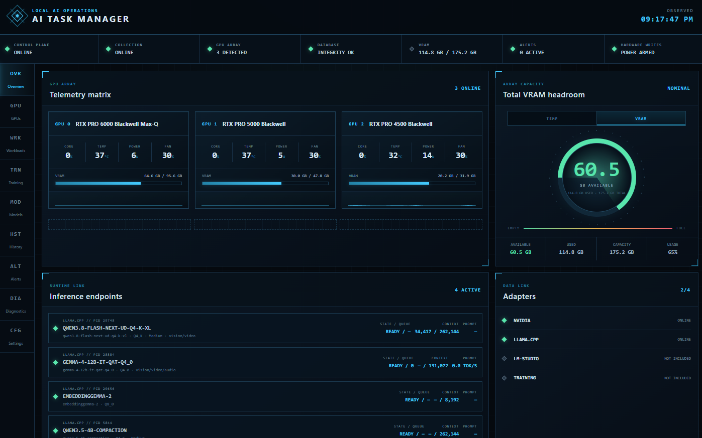

# AI Task Manager for Windows

AI Task Manager is a native Windows dashboard for monitoring local NVIDIA GPUs and AI inference workloads. It combines GPU telemetry, running model information, llama.cpp runtime details, history, alerts, and guarded hardware controls in a single cockpit-style interface.

> **Alpha software:** `0.1.0-alpha` is unsigned and intended for evaluation. Monitoring is the primary supported use case. NVIDIA power and GPU fan controls are experimental.



## What it shows

- NVIDIA GPU utilization, VRAM, temperature, power, clocks, fan state, and processes.
- Aggregate thermal margin and total VRAM headroom.
- Automatically discovered local `llama-server` workloads.
- Loaded model, model format, context size and occupancy, slots, queue state, KV-cache types, throughput, build information, and modalities when exposed by llama.cpp.
- Rolling GPU history, live alerts, data-source health, application diagnostics, and local storage status.
- Device-reported power and fan operating ranges rather than hard-coded GPU values.

## What works in this alpha

| Feature | Status |
| --- | --- |
| Native Windows desktop application | Working |
| NVIDIA GPU discovery and telemetry | Automatic with a compatible NVIDIA driver |
| Multiple NVIDIA GPUs | Working; GPUs are identified by UUID |
| NVIDIA process enumeration | Working; per-process VRAM may be unavailable under Windows WDDM |
| Local llama.cpp discovery | Automatic for `llama-server` and `llama_server` processes |
| Explicit llama.cpp endpoints | Supported |
| Context, slots, KV cache, queue, and throughput | Available when the llama.cpp server exposes the relevant endpoints |
| Diagnostics, rolling metrics, and alerts | Working |
| NVIDIA power-limit controls | Available, guarded, elevated, verified, and experimental |
| NVIDIA GPU-local fan controls | Available, watchdog-protected, and experimental |

## Not wired up yet

The following features cannot currently be enabled by changing configuration:

- LM Studio runtime details.
- Generic OpenAI-compatible runtime details.
- Ollama, vLLM, TensorRT-LLM, and other engine-specific integrations.
- Training-run monitoring and trainer heartbeats.
- Model inventory and placement planning.
- Lenovo chassis, CPU, pump, motherboard, or embedded-controller fan control.

Unsupported inference engines may still appear as NVIDIA processes with GPU utilization and VRAM activity. Loaded-model, context, KV-cache, slot, queue, and throughput details require an engine-specific adapter and a custom source build. Adding an endpoint URL alone is not sufficient.

## Requirements

- 64-bit Windows 10 or Windows 11.
- Microsoft Edge WebView2 Evergreen Runtime.
- A compatible NVIDIA display driver for NVIDIA telemetry and hardware controls.

The portable release includes the .NET runtime. Users do not need to install the .NET SDK, Node.js, Python, CUDA Toolkit, or model-training packages simply to run the dashboard.

## Install and run

1. Download the Windows ZIP and matching `.sha256` file from [Releases](https://github.com/axiomofmind/Windows-AI-Task-Manager/releases).
2. Verify the ZIP checksum.
3. Extract the complete ZIP to a normal folder. Do not run it from inside the archive.
4. Open `AITaskManager.Desktop.exe` as a standard user.
5. Accept the Windows unsigned-application warning if it appears.

Do not move the executable out of its extracted folder; it relies on the supporting files beside it.

Closing the main window sends AI Task Manager to the notification area by default. Use **Exit** from the tray menu to shut down collection and restore any app-owned hardware session cleanly.

## llama.cpp monitoring

Start `llama-server` normally. AI Task Manager discovers loopback listeners owned by local `llama-server` processes without scanning arbitrary ports.

For the richest telemetry, start llama.cpp with its metrics and slot endpoints enabled. The adapter can query:

- `/health`
- `/props`
- `/slots`
- `/metrics`

Optional endpoints may be absent without preventing basic health monitoring. Explicit llama.cpp endpoints can also be added to the per-user configuration for authenticated, remote, or unusually named servers.

## Hardware controls and safety

Hardware controls are visible on first launch, but the application never changes power or fan behavior automatically.

Power-limit changes:

- Use the minimum, maximum, current, and factory-default limits reported by that GPU.
- Require an explicit confirmation and Windows administrator approval.
- Are read back and verified after application.
- Can be restored to the GPU's reported factory default.

Manual fan sessions:

- Work only with NVIDIA GPU-local fan channels exposed through supported NVML calls.
- Require confirmation that competing fan utilities are closed.
- Require Windows administrator approval when a session begins.
- Treat the selected duty as a minimum, not a fixed speed.
- Automatically increase cooling as temperature approaches a device-derived ceiling.
- Attempt to restore NVIDIA automatic fan policy after disable, application exit, heartbeat loss, IPC failure, or telemetry failure.

Fan support depends on the exact GPU, driver, and VBIOS. If a device does not report defensible fan limits or thermal thresholds, the application refuses manual control instead of guessing.

Do not run AI Task Manager fan control at the same time as Fan Control, MSI Afterburner, EVGA Precision X, or another program that writes the same GPU fan channels.

## Local data and privacy

AI Task Manager operates locally and does not send usage telemetry to an external service.

On first launch it creates:

```text
%LOCALAPPDATA%\AITaskManager\config.json
%LOCALAPPDATA%\AITaskManager\data\aitaskmanager.db
%LOCALAPPDATA%\AITaskManager\logs\
```

- The application API binds to loopback only.
- Prompt and response bodies are not collected.
- Models, datasets, and checkpoints are not scanned automatically.
- Local configuration, databases, logs, models, and credentials are not included in release archives.
- Runtime discovery is limited to local llama.cpp process listeners.

Configuration is loaded at startup. After changing `config.json`, use **Exit** from the tray menu and reopen the application.

## Adding another inference engine

This alpha does not include a drop-in plugin loader. Supporting another engine currently requires a source-code adapter that:

- Uses the engine's documented native API.
- Maps only observed values and leaves unavailable telemetry empty.
- Stores credentials through the application's protected secret store.
- Avoids hard-coded paths, ports, process IDs, model names, and API keys.
- Preserves existing llama.cpp behavior.
- Includes tests for healthy, offline, unauthorized, malformed, slow, and partially supported endpoints.

LM Studio integration should use its native REST API where possible. A generic OpenAI-compatible `/v1/models` endpoint can provide basic model identity, but normally cannot provide context occupancy, KV-cache allocation, slots, or detailed throughput.

## Current limitations

- The alpha is unsigned and Windows may show an unknown-publisher warning.
- Microsoft WebView2 must already be installed.
- Hardware-control coverage varies by GPU, driver, and VBIOS.
- Fan control has not completed the full crash, sleep/resume, driver-reset, and thermal-ramp qualification matrix.
- Per-process VRAM can be unavailable under Windows WDDM.
- Only llama.cpp has a functional runtime adapter in this release.
- There is no installer or automatic updater yet.

## License

AI Task Manager is licensed under the Apache License 2.0. See `LICENSE` for details.

Report security vulnerabilities using the instructions in `SECURITY.md`. Please do not disclose suspected vulnerabilities in a public issue.
